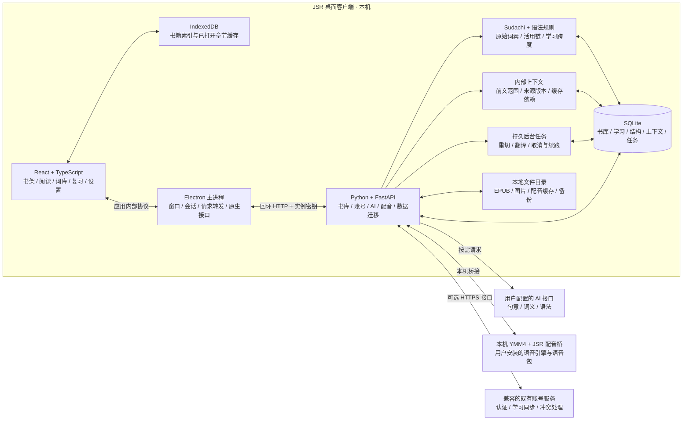

# JSR

面向日语学习者的 Windows 桌面阅读器，将原文阅读、句意理解、语法学习、词汇积累和间隔复习连在一起。

**版本：0.5.1 · 平台：Windows x64 · 许可证：AGPL-3.0-or-later**

[快速开始](#快速开始) · [功能介绍](#功能介绍) · [分享与数据迁移](#分享与数据迁移) · [架构概览](#架构概览) · [开发与构建](#开发与构建) · [许可证与源码](#许可证与源码) · [反馈问题](https://github.com/H0rR1p/JapStudyReader/issues)

## 项目说明

导入 EPUB、TXT 或粘贴日文后，可以在阅读中查看振假名、理解句意和语法，把遇到的词加入卡片，并通过复习逐渐减少对阅读辅助的依赖。

书籍与学习数据保存在本机。已有正文、分析结果和复习内容可离线使用；生成新的 AI 释义和语法分析需要配置自己的接口。配音可连接本机 YMM4。

当前仓库的 `main` 分支维护 Windows 桌面客户端及其本机 Python 服务。自 2026 年 10 月 9 日起，项目不再开发、构建或部署 Android 和公网版本。

## 最新更新

### 0.5.1 · 2026-10-10

- 桌面产品名称统一为 **JSR**，迁移到 [H0rR1p/JapStudyReader](https://github.com/H0rR1p/JapStudyReader)。
- 移除应用 Logo、衍生图标和 Logo 点击音频，保留现有页面的配色与布局风格。
- README 改为文字介绍，保留架构图。
- 保留原有本机数据目录，已有书籍、词卡、阅读进度和学习记录继续使用。
- 保留现有阅读、语法学习、AI 释义、配音、复习、书籍分享和数据迁移功能；代码许可及第三方声明继续保留。

### 0.5.0 的语法与许可改进

常见敬语与授受组合按完整表达展示词典形和变化过程；88 条原创定式说明使用简短中文。无法可靠确定的结构保留候选，支持人工确认和清除。

发行包随附应用及运行依赖的对应源码、许可证、上游补丁和构建说明。发布构建核验对应源码与原生运行库的 SHA-256，缺少材料或未经审校的运行库升级会阻止发布。

## 功能介绍

### 原文阅读与逐句理解

- **导入与整理**：支持无 DRM 的 EPUB、UTF-8 TXT 和粘贴文本；支持合集、自定义封面和最近阅读。
- **封面与插图**：实际封面每次启动默认隐藏，书内插图默认关闭；插图开关按书统一管理，阅读中也可切换。
- **阅读辅助**：提供本地切词、词典形、读音与振假名；点击词语查看词义和当前语境义。
- **逐句释义**：快速句意生成中文译文；完整释义额外补充词典未命中的词义。语法句法分析按需生成。
- **释义修正**：可使用「AI 修正释义」，查看预览后确认保存，也可手动修正个人词库。
- **阅读定位**：保存章节与句子位置，提供句子书签、上一节／下一节和「继续阅读」；左右侧栏均可收起。
- **原书预览**：保留 EPUB 原书与资源，支持查看原书排版。
- **后台处理**：可处理当前章节或全书，显示进度并支持取消；已完成结果保留供下次使用。

### 活用、语法与上下文

- **完整学习单位**：将活用链与常见定式组合为可点击结构，展示词典形、读音和词形变化。原始词素作为内部分析数据保留。
- **简单中文解释**：本地定式说明和 AI 语法分析优先解释含义、用法和变化过程。
- **前文范围**：可选择前 0、2、4 或 8 句；手动释义、后台翻译与词义修正使用同一规则。已有译文作为辅助线索，缺少人物性别证据时使用中立称呼。
- **人工确认候选**：有多种解释时可手动选择或清除；不能可靠确定的结构不自动调用 AI 判定。
- **重新切分**：已切分章节可重新切分，也可对全书发起任务。新结果经过暂存校验后激活，保留阅读位置、书签映射和卡片历史例句，支持查看版本并恢复。
- **语法卡片**：从已识别结构创建「识别含义」或「恢复形式」卡片，进入卡片管理与每日复习。

翻译结合前文和内部上下文资料，减少人物称呼、指代与语境理解错误。人物及原文证据仅用于 AI 请求，不提供读者管理页面；没有依据的性别保持未知。

### 个人词库与卡片复习

个人词库支持词形、读音和释义搜索，可按假名、词性、来源及自定义分组浏览，并提供分页、虚拟列表和批量修正。可导入自己有权使用的 Yomitan 格式日中词典。

阅读中的词语与语法结构可加入卡片，支持标签、筛选、编辑和合并。每日复习使用四档反馈与学习上限，知识状态参与阅读辅助的调整。重新切分不会清空已有复习历史。

### 本机账号与学习统计

无需云端账号即可使用。可设置昵称与头像，在不同本机资料空间之间切换。个人主页展示学习时间热力图、连续学习天数、近期趋势及待复习卡片。

### 本地配音

连接本机 YMM4 后，可为句子和单词生成配音。支持角色选择、语速调整、本地音频缓存和重新生成；默认语速为 `0.85×`，音高固定。

安装包不包含 YMM4 或专有语音包，使用方式见[配音配置](#配音配置)。

## 快速开始

### 安装客户端

使用项目维护者提供的 `JSR-<版本号>-Setup.exe`，按安装向导选择目录。安装版自带运行环境，日常使用无需安装 Node.js 或 Python。

目录版需要保留整个 `win-unpacked` 文件夹，不能只复制 `JSR.exe`。安装包附带完整对应源码，体积包含这些许可交付材料。

### 第一次阅读

1. 以本机模式进入，或选择已有本机账号。
2. 点击「导入书籍」，选择 EPUB、TXT 或粘贴日文。
3. 打开书籍并选择章节；已有切分直接复用，也可重新切分。
4. 在设置页配置 AI 接口地址、模型与密钥，点击「释义本句」或启动后台翻译。
5. 将需要积累的词加入词卡，在「今日复习」中巩固。

| 模式 | 生成内容 | 适合的用法 |
| --- | --- | --- |
| 快速句意 | 中文句意，不补充词语翻译 | 先读懂故事、预先翻译全书 |
| 完整释义 | 中文句意、未命中词的词义与本句语境义 | 逐句学习、积累词汇 |
| 本地学习结构 | 完整活用链、常见定式、步骤与候选 | 点击学习单位查看，不产生 AI 请求 |
| 语法句法分析 | AI 对句中结构的按需解释 | 遇到难句时单独调用 |

AI 接口可能按用量收费。设置页可查看 token、缓存命中、耗时和估算费用；本地切词与已有结果复用不产生 AI 请求。

### 配音配置

1. 自行安装可正常合成语音的 YMM4 及所需语音包。
2. 在设置页的配音区域指定 `YukkuriMovieMaker.exe`，导入包含目标角色的 `.ymmp` 模板。
3. 选择声音并保存，点击「配音本句」或「播放读音」。

JSR 使用自己的配音桥，由 YMM4 调用其语音引擎。首次安装或更新配音桥时，需要保存项目并完全退出 YMM4，再重新触发配音。生成音频时应保持系统输出设备可用。

配音本身不调用 AI；语音引擎与语音包的使用范围遵循各自许可。

## 分享与数据迁移

### 分享选中的书籍

在书架点击「分享书籍」，选择一本或多本并导出分享包。接收方点击「载入分享包」，即可读取书籍及其已有分析结果。

分享包包含正文、封面、插图、章节、切分、翻译和相关词义。未完成分析的书籍保留已有结果，接收方可继续处理。

### 数据包类型

| 类型 | 入口 | 包含内容 | 用途 |
| --- | --- | --- | --- |
| 书籍分享包 | 书架 → 分享书籍／载入分享包 | 所选书籍、资源、切分、翻译、相关词义；不含个人阅读进度、书签、卡片、学习记录和账号设置 | 分享一本或多本书 |
| 跨账号数据迁移包 | 设置 → 数据备份与恢复 | 书籍、资源、阅读进度、书签、个人词库、卡片、复习状态与学习记录；不含密码、会话和 API 密钥 | 更换账号或设备；向支持该格式的既有账号服务迁移 |
| 完整本地备份 | 设置 → 数据备份与恢复 | 当前账号的本地数据与设置，包含 API 密钥 | 备份与恢复本机数据 |

分享包和迁移包跳过目标账号已有的书籍，避免覆盖。完整备份恢复会替换当前账号数据，恢复前自动保存一份安全备份。

完整备份与迁移包默认使用 schema 3，保留语法学习、内部上下文修订和学习引用所需的历史来源。兼容导出面向旧客户端，导出前显示不能表示的数据。书籍分享包只包含激活版本的书籍分析，不包含个人上下文记录或人工覆盖。

既有同步接口先协商服务端能力；不支持新版领域的服务显示未传输项，旧版本写回不会静默覆盖已更新的切分来源。同步接口不上传 AI 密钥或 YMM4 文件。

## 数据保存在哪里

桌面版继续使用 `%APPDATA%\IceReader\data`，保留历史目录名以直接读取已有数据。可在设置页打开实际数据目录。

```text
data/
├── books/                  原书副本、封面、插图与原书预览
├── library.sqlite3         书籍、章节、切分、释义与阅读进度
├── learning.sqlite3        词卡、复习与学习记录
├── linguistics.sqlite3     学习结构、跨度词义与人工修订
├── book_memory.sqlite3     内部上下文及其修订历史
├── jobs.sqlite3            后台任务、预算与断点
├── dictionary.sqlite3      用户导入的词典
├── ai.sqlite3              AI 用量与缓存记录
├── users/                  按用户隔离的设置
├── voice/                  配音模板与音频缓存
└── backups/                备份与恢复前的安全副本
```

导入 EPUB 时，原书与资源复制到专用目录，后续阅读不依赖原始文件位置。数据目录与安装目录分离，客户端升级无需重新导入书籍。

## 架构概览

Electron 承载 React 界面，并启动仅监听本机回环地址的 Python 服务。主进程转发请求并验证实例密钥，SQLite 与本地文件保存业务数据，IndexedDB 仅作为界面缓存。



| 边界 | 处理方式 |
| --- | --- |
| 界面与系统 | 渲染进程启用沙箱、关闭 Node 集成；原生操作通过有限桥接接口完成 |
| 本机服务与数据 | 主进程管理服务启停；按用户隔离保存，正文按章读取、分析结果增量写入 |
| AI 与本地处理 | 本地完成分词、活用链与定式识别；新释义和 AI 语法解释按明确范围请求 |
| 来源与后台任务 | 重切经过暂存和版本校验激活；保留历史来源，任务在安全边界取消并记录断点 |
| 配音与客户端 | YMM4 单独安装，通过本机配音桥调用；专有语音包不随安装包分发 |
| 既有同步与数据迁移 | 同步传输学习相关数据，完整书籍资源通过迁移包载入 |

阅读与学习流程：导入内容 → 阅读与按需释义 → 积累词汇 → 词卡复习 → 更新知识状态 → 调整后续阅读辅助。

## 开发与构建

开发环境：Windows x64、Node.js 22+、Python 3.12 x64。准确依赖版本由锁文件与发行源码包记录。

```powershell
git clone https://github.com/H0rR1p/JapStudyReader.git
cd JapStudyReader
python -m venv .venv64
.\.venv64\Scripts\python -m pip install -r backend\requirements-cloud.txt
npm ci
npm run desktop:dev
```

`requirements-cloud.txt` 保留历史文件名，包含本机服务与账号模块所需的依赖。桌面客户端自动启动内部服务，日常开发无需单独启动 API 或打开系统浏览器。

### 构建安装包

```powershell
.\.venv64\Scripts\python -m pip install -r backend\requirements-build.txt
.\.venv64\Scripts\python.exe scripts/prepare_legal.py --fetch
npm run desktop:build
```

成功构建生成独立目录：

```text
build/desktop-release-<构建时间>/
├── JSR-<版本号>-Setup.exe
└── win-unpacked/            完整目录版，包含 JSR.exe
```

`build/desktop-current.txt` 记录最新构建，根目录 `JSR.exe` 启动器据此打开客户端。构建流程核验 Windows 可执行文件资源及安装包内容。

### 检查代码与客户端

```powershell
npm run build
.\.venv64\Scripts\python -m pytest backend
npm run desktop:test
```

验证打包版本时，将 `BINGDU_TEST_EXECUTABLE` 设为对应 `win-unpacked\JSR.exe` 的完整路径。该环境变量保留历史名称。

### 项目结构

| 目录 | 职责 |
| --- | --- |
| `desktop/` | Electron 主进程、窗口、内部服务生命周期与原生接口 |
| `src/features/` | 书架、阅读、词库、卡片、复习、个人主页与设置 |
| `backend/` | FastAPI 服务、日语处理、AI、配音与 SQLite 存储 |
| `backend/modules/` | 账号、学习、兼容同步与迁移等业务模块 |
| `assets/`、`public/` | 构建资源及自有配音桥 |
| `scripts/` | 构建、验收、许可交付与性能检查工具 |
| `third_party_licenses/` | 第三方清单、许可原文与原生组件来源记录 |

长章节按章与分批加载，保存采用增量更新；后台翻译使用动态组批、缓存和可调并发。Sudachi 字典在需要分词时加载，语言分析、内部上下文与迁移按用户和来源版本隔离。

需要调试界面时，可分别启动本机内部服务与 Vite：

```powershell
.\.venv64\Scripts\python -m uvicorn backend.app:app --host 127.0.0.1 --port 8000
npm run dev
```

## 反馈与贡献

通过 [GitHub Issues](https://github.com/H0rR1p/JapStudyReader/issues) 提交问题和建议。报告问题时请提供版本、操作步骤、预期与实际结果；书籍解析问题可提供有权分享的最小样例。提交修复时请说明修改内容和验证方式。

## 许可证与源码

JSR 的应用代码、构建脚本与文档采用 **AGPL-3.0-or-later**，详见 [LICENSE](LICENSE) 与 [COPYRIGHT](COPYRIGHT)。改名及仓库迁移不改变已有代码许可，也不改变第三方权利归属。程序按现状提供，不提供担保。

- 保留 EbookLib 0.19 作为 EPUB 解析器，遵守其 AGPL 许可。
- 组件版本、许可原文和版权信息见[第三方清单](third_party_licenses/inventory.json)、[THIRD-PARTY-NOTICES.txt](THIRD-PARTY-NOTICES.txt) 与 [NOTICE.md](NOTICE.md)。
- 「下载对应源码」提供与发行版匹配的完整源码包，包含应用源码、构建脚本、锁定版本和运行依赖的原始源码包。
- 修改或分发时须保留相应声明并提供对应源码。通过网络提供修改版时，也须向使用者提供实际运行版本的对应源码；不要以不断变化的 `main` 链接替代。
- YMM4 与专有语音包由用户自行安装，不随客户端分发。独立配音桥的有限互操作附加许可见 [ymm4-bridge/COPYRIGHT](ymm4-bridge/COPYRIGHT)，仅覆盖自有桥接代码。
- 书籍、词典及语音包遵循各自许可，仅导入或分享有权处理的内容。
- 桌面架构参考 [Aozora](https://github.com/meokisama/aozora)，未复制其应用源码或素材；参考关系与第三方声明继续保留。

发行包提供匹配 Electron 42.4.0／Chromium 148.0.7778.254 的上游源码、精确 FFmpeg 提交、补丁及 Windows 构建配置，并提供 FFmpeg DLL 替换和运行时重新链接说明。构建核验源码归档及实际运行时的 SHA-256。详见[原生组件清单](third_party_licenses/runtime/desktop-native/manifest.json)与[源码构建说明](SOURCE-BUILD.txt)。

`build/legal/corresponding-source.zip` 随客户端安装，ZIP 内的 `SOURCE-MANIFEST.json` 记录版本、基准提交及应用文件哈希。应用源码位于 `JSR/`，依赖归档位于 `dependency-sources/`。在 `JSR/` 内使用 Python 3.12 创建 `.venv64`，安装 `backend/requirements-release.txt`，运行 `npm ci`、`scripts/prepare_legal.py --fetch` 和 `npm run desktop:build`。常规重建需要联网取得工具及同版本官方 wheel，原生依赖重建还需要上游规定的 C/C++、Rust 工具链。

当前许可材料对应当前源码与发行版本。继续分发历史安装包时，仍需提供与该旧版本匹配的许可、源码和构建材料。
